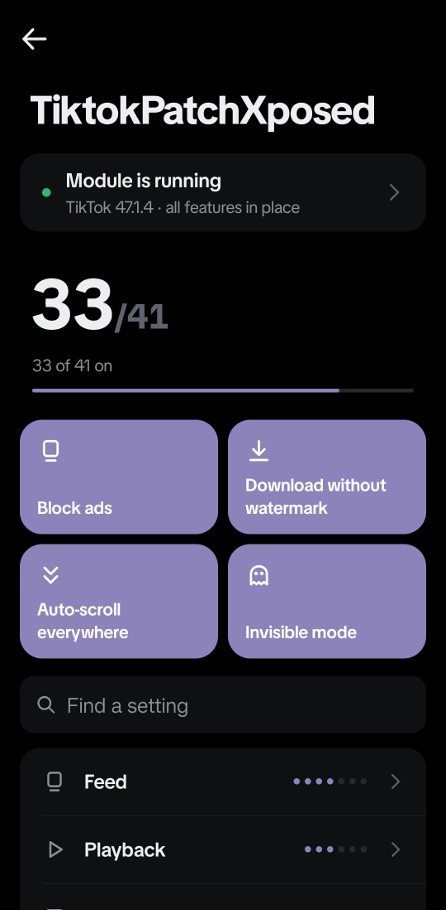
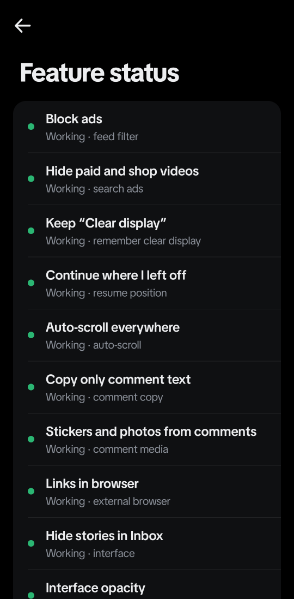
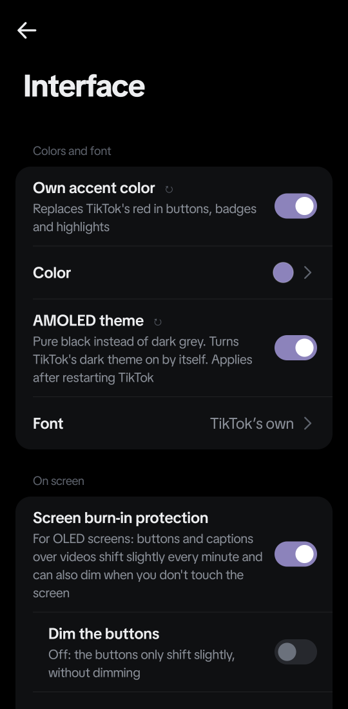
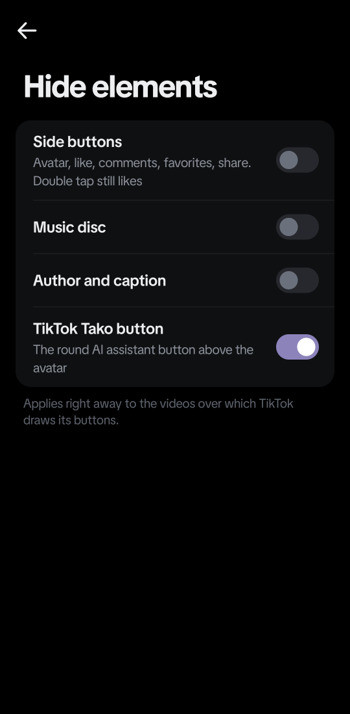
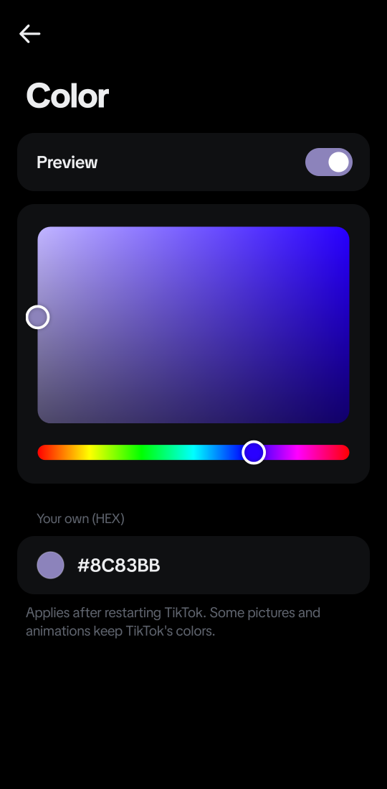
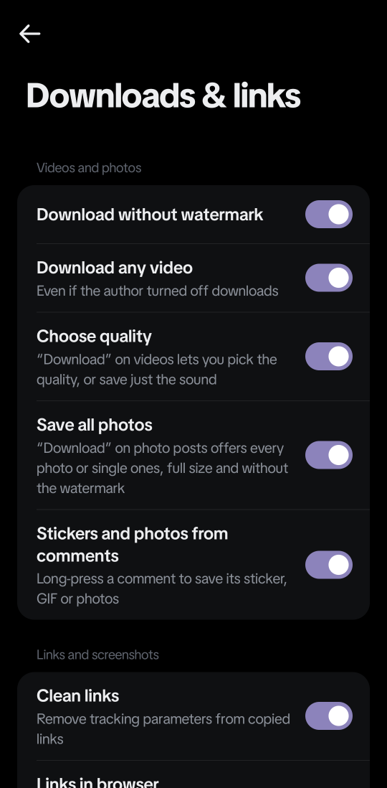

# TiktokPatchXposed

[Русский](README-RU.md) | [Indonesia](README.md) | **English**

> Tested on **TikTok 47.1.4** from Google Play and **Android 16**. Most features find what they
> need in TikTok on their own, so they survive its updates. If something stops working after a
> TikTok update, check "Feature status" in the module's settings and report it in
> [issues](https://github.com/hik0w/TiktokPatchXposed/issues).

An LSPosed module for TikTok. It removes ads, downloads anything in the quality you want, turns on
features TikTok only gives to some users, and adds plenty of extras: auto-scroll everywhere, your
own accent color and an AMOLED theme, hiding parts of the interface, country flags, invisible mode
and stickers instead of streak flames. All settings live inside TikTok and look native.

Current version: **4.1.0**.

### Test features 🧪

Features marked 🧪 are done and can be turned on, but are not fully verified. They may not work,
or may work differently from what is described. All of them are off by default.

- **No forced sign-in** — not tested yet on a real device without a TikTok account.
- **Invisible mode** (story, profile and video views) — TikTok's view reports are confirmed to be
  cancelled, but how it looks to other people hasn't been confirmed yet.
- **Block location, hide VPN, random device ID** — the module changes what Android tells TikTok,
  but not every way TikTok might find out can be checked.

If a test feature works (or doesn't) for you, please say so in issues — it helps a lot.

## Screenshots

<p align="center">
  
  
  
</p>
<p align="center"><sub>Settings inside TikTok · feature status for your version · the Interface section</sub></p>

<p align="center">
  
  
  
</p>
<p align="center"><sub>Hide elements · your own accent color · downloads and links</sub></p>

## Install

**You need:** Android 8.1 or newer, root and [LSPosed](https://github.com/JingMatrix/LSPosed)
(modern libxposed API 101–102 or the old LSPosed 1.9.x), TikTok from Google Play
(`com.zhiliaoapp.musically`; `com.ss.android.ugc.trill` is supported too but untested).

1. Download the APK from the latest [release](https://github.com/hik0w/TiktokPatchXposed/releases/latest) and install it.
2. In LSPosed, enable the module and tick TikTok in its app list.
3. Force stop TikTok (Android Settings → Apps → TikTok → Force stop) and open it again.
4. Open the module's settings (see below) — "Module is running" is shown at the top.

### Where to find the settings

TikTok → Profile → ☰ → Settings and privacy → **TiktokPatchXposed** (the very first row).

The module has no separate app: the settings button in LSPosed opens the same screen inside
TikTok. The screen follows TikTok's look, theme and language. It is translated into Russian,
English, Ukrainian, German, Spanish, Portuguese, French, Italian, Polish, Turkish and Indonesian;
Belarusian and Kazakh use Russian, other languages use English.

Some settings apply only after restarting TikTok (region, accent color, AMOLED theme, random ID
and server-side experiments) — a "Restart" button then appears at the bottom of the screen.

### Updating

Install the new APK over the old one; settings are kept. Restart TikTok afterwards. What's new is
in each [release](https://github.com/hik0w/TiktokPatchXposed/releases). To back up or move your
settings: *Feature status → Export / Import settings*.

### Troubleshooting

- **The module isn't in TikTok's settings** — check that the module is enabled in LSPosed with
  TikTok ticked, then force stop TikTok.
- **A feature stopped working after a TikTok update** — open "Feature status" (the "Module is
  running" card at the top). "Not found in this TikTok version" means the module skips that
  feature. Report it in issues with your TikTok version.
- **A setting didn't apply** — if there is a "Restart" button at the bottom, tap it.
- **TikTok asks to "restore the app"** — that's TikTok's safe mode after crashes. Tap **Cancel**,
  not "Restore": restoring wipes TikTok's data.
- **Anything else** — open an [issue](https://github.com/hik0w/TiktokPatchXposed/issues) with your
  TikTok version, module version, a screenshot of "Feature status" and, if you can, the LSPosed log.

## Features

### Feed

| Feature | How it works |
| --- | --- |
| No ads | Removes ads from the feed, the startup splash ad, ads inside videos and in other video lists |
| Hide paid and shop videos | Paid content, videos selling shop products and ads in search |
| Hide AI videos | Videos labelled "AI-generated" by the creator or TikTok |
| Own filter | Hides recommendations by words and hashtags, authors, minimum likes and views |
| Hide LIVE | Live streams in the feed and the LIVE button in the top left corner |
| Hide "People you may know" | Videos TikTok suggests from your contacts |
| Seek bar everywhere | Including short videos |

### Playback

| Feature | How it works |
| --- | --- |
| Auto-scroll everywhere | When a video ends, the next one opens: in profiles, search, Following and chats. Photo posts move on by the music length, about 3 seconds per photo. The switch is also in the long-press menu on a video. For You uses TikTok's own auto-scroll |
| Own speeds | Any speeds from 0.25 to 3 in TikTok's speed menu |
| Remember speed | The chosen speed stays for the next videos |
| Keep "Clear display" | Clear display stays on when you scroll |
| Continue where I left off | A video you scroll back to continues instead of starting over |

### Interface

| Feature | How it works |
| --- | --- |
| Hide elements | Side buttons, music disc, author and caption, the TikTok Tako (AI assistant) button. The module hides TikTok's own components, so each switch hides only its parts and brings them back as soon as it is off. Double tap still likes |
| Interface opacity | Buttons, author and caption over videos become see-through |
| Burn-in protection | For OLED: the buttons shift slightly every minute and, with "Dim the buttons", dim while you don't touch the screen |
| Own accent color | Replaces TikTok's red: Follow buttons, the "+" under the avatar, badges, unread counters, liked comments. 8 ready colors or your own HEX |
| AMOLED theme | Pure black instead of dark grey in TikTok's dark theme |
| Hide stories in Inbox | The row of stories above your chats |
| 🧪 No forced sign-in | Without an account, TikTok doesn't block the app with a sign-in screen |

### Comments & profile

| Feature | How it works |
| --- | --- |
| Auto-translate comments | Comments in other languages are translated with TikTok's own translator. You can list languages to leave alone |
| Author's country | A flag next to the video date and next to the name in profiles (see the note below) |
| Copy only comment text | "Copy" on a comment leaves out the author's name |
| Links in browser | Website links from profiles and stories open in your browser, not inside TikTok |
| Comment reposts, new profile | TikTok's server-side experiments; the module turns them on for you |
| Hidden TikTok features | Long-press speed-up, comments to Favorites, audio and photo comments, background playback and more |

> **The flag isn't where someone lives.** The module shows the region TikTok keeps for the
> author's account (or the video's region if there is none). TikTok assigns it itself, usually at
> sign-up, from the SIM card, IP address and device language. So the flag doesn't necessarily
> match where the person lives now: they may have moved, use a VPN or region spoofing, or have
> signed up in another country.

### Downloads & links

| Feature | How it works |
| --- | --- |
| No watermark | Downloads videos without the watermark |
| Download any video | Even when the author turned downloads off |
| Choose quality | "Download" opens a sheet: qualities with file sizes, "Sound only" and TikTok's normal save |
| All photos from a carousel | On photo posts: all photos at once, full size and without the watermark, or pick single photos |
| Stickers and photos from comments | Long-press a comment → "Download sticker" (GIFs too) or "Download photo" |
| Screenshots everywhere | Screenshots and screen recording work where TikTok blocks them, dialogs included |
| Clean links | A short `vt.tiktok.com/…` link (which tells TikTok who shared it) is replaced with the plain video link a second after copying; `_r`, `_t`, `u_code`, `share_link_id` and other trackers are stripped from long links |

### Region

| Feature | How it works |
| --- | --- |
| Country | Spoofs the SIM country and carrier, about 190 countries. Germany by default; pick another or turn it off. The time zone name follows that country with the same clock time, so your clock stays right |
| Recommendations in my language | Recommendations in the language set in TikTok. Turn it off to get videos picked for the chosen country |
| Fresh videos only | Hides recommendations older than a chosen period (a week to 2 years, or your own) |

> **The region isn't guaranteed.** The module only changes what TikTok learns about the device:
> the SIM country, carrier and time zone. It doesn't change your account's own region (TikTok
> remembers it from sign-up), your IP address or other signals. So recommendations, available
> features and your account's region won't necessarily match the chosen country exactly.

### Invisible mode

Everything is off by default, and all of it is a test feature (see [Test features](#test-features-)).

| Feature | How it works |
| --- | --- |
| 🧪 Hide story views | Authors won't see you among their story viewers |
| 🧪 Hide profile visits | Turn on TikTok's profile view history to see your visitors without showing up in other people's lists |
| 🧪 Hide video views from people I follow | With view history on, they won't see which of their videos you watched |
| 🧪 Block location | TikTok sees location as off and gets no coordinates from GPS or the network |
| 🧪 Hide VPN | TikTok doesn't see that the connection goes through a VPN |
| 🧪 Random device ID | TikTok gets a random Android ID instead of the real one. Applies after a restart; TikTok may ask you to sign in again |

### Streaks

| Feature | How it works |
| --- | --- |
| Auto streaks | Keep existing streaks alive, see below |
| What to send | The flame or a sticker from your favourites. If the sticker is no longer a favourite, the flame is sent |

### The settings screen

Search across all settings, "Feature status" (what was found in your TikTok version), and settings
export and import as a single line of text.

## Auto streaks

Turned on manually. The module only keeps existing streaks in one-to-one chats alive, and only
when a streak is about to expire. It sends TikTok's normal `spark_v1` interaction (or the chosen
sticker), not a text message. It works while TikTok is open: no alarms, no background services.
Every send is recorded first, so the same streak is never extended twice a day. The module waits
a few seconds between chats, as if you went through them by hand. If TikTok rejects a streak, you
get a notification — check that chat yourself.

## Compatibility

Earlier, every TikTok update meant adapting the module to new class names. Now it relies only on
TikTok's readable class and method names and finds the obfuscated parts itself on the first start
of a new version (by strings and signatures) — that takes a fraction of a second and the result is
remembered. So new TikTok versions will most likely work without a module update. This can't be
guaranteed: a feature that can't be found is skipped and shown in "Feature status".

The module uses LSPosed's modern API (libxposed 101–102), so new LSPosed versions don't mark it as
"legacy". Old LSPosed 1.9.x is supported too: the APK keeps the previous entry point for it.

## Limitations

- TikTok's home screen icon can't be changed: a module can't change TikTok's manifest.
- TikTok draws some of its UI from pictures and Jetpack Compose, so a few small parts stay red
  even with your own accent color.
- Region changes what TikTok learns about the SIM card, carrier and time zone, not your account's
  region or your IP address, so the result isn't guaranteed.
- Test features 🧪 are not fully verified (see above).

## Building

Requires Java 17 and Android SDK 36.

The whole project lives in the `source/` folder:

```shell
cd source
./gradlew testDebugUnitTest assembleRelease
```

The APK lands in `source/app/build/outputs/apk/release/`.

### Project structure

```text
source/                  the module's Gradle project
docs/media/              screenshots for the README
.github/workflows/       build and tests on GitHub Actions

source/app/src/main/java/com/golda/patchertiktok/
  ModuleMain, MainHook   entry points for new and old LSPosed
  Module                 starts every feature; each is isolated and can't break the others
  Hooks, Reflect         wrapper over the LSPosed API, and reflection
  Discovery, DexFinder   finds TikTok's obfuscated classes by strings and signatures
  Prefs, I18n            settings and translations into 11 languages
  ModSettingsActivity    the settings screen inside TikTok
  FeedFilter, ContentFilter, ...   feed and filters
  AutoScroll, PlaybackSpeed, ...   playback
  Overlay, AccentColor, ...        interface
  DownloadsPlus, CommentMedia, ... downloads
  RegionSpoof, Ghost, Privacy      region and invisible mode
  AutoStreakManager, StreakSticker streaks
```

## Disclaimer

Modifying the client and automated actions may get your account restricted. Use at your own risk.
This is an unofficial project, not affiliated with TikTok or ByteDance.

## License

Licensed under **MIT**, see [LICENSE](LICENSE).
