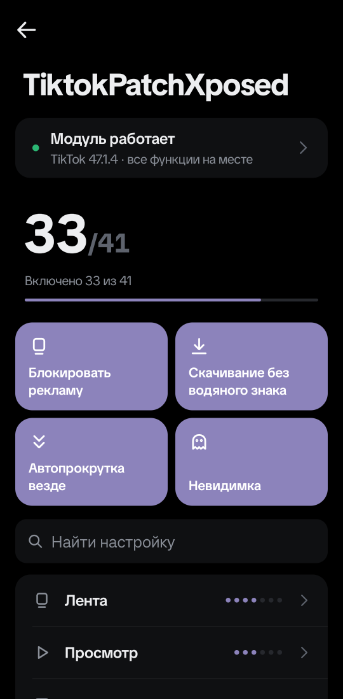
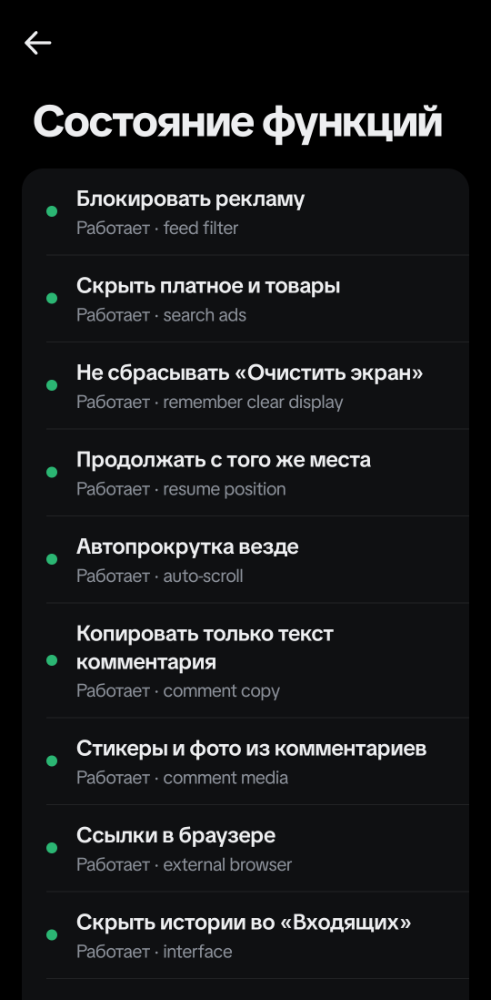
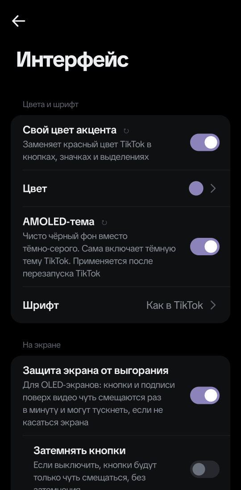
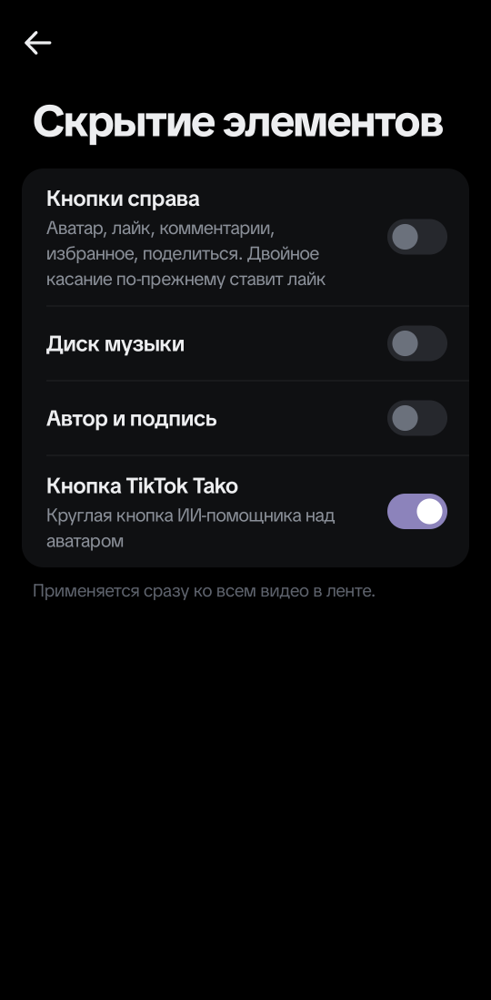
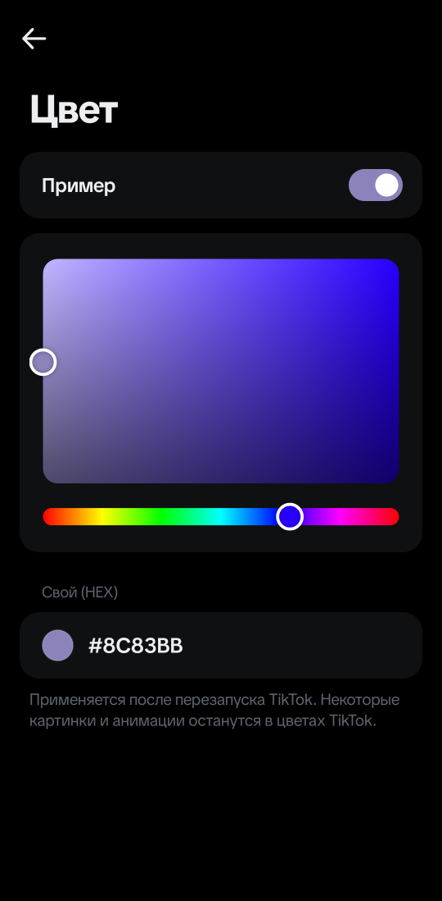
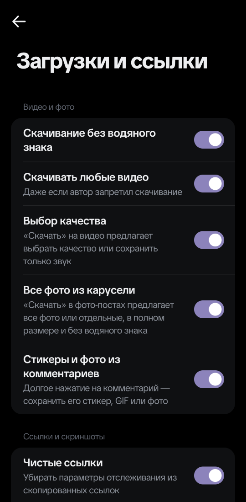

# TiktokPatchXposed

**Русский** | [English](README-EN.md)

> Проверено на **TikTok 47.1.4** из Google Play и **Android 16**. Большинство функций сами
> находят нужные места в TikTok, поэтому переживают его обновления. Если после обновления TikTok
> что-то перестало работать, загляните в «Состояние функций» в настройках модуля и напишите в
> [issues](https://github.com/hik0w/TiktokPatchXposed/issues).

LSPosed-модуль для TikTok. Убирает рекламу, даёт скачивать что угодно в нужном качестве,
включает функции, которые TikTok открывает не всем, и добавляет много мелочей: автопрокрутку
везде, свой цвет и AMOLED-тему, скрытие элементов, флаги стран, невидимку и стикеры вместо
огоньков. Все настройки находятся прямо внутри TikTok и выглядят как родные.

Текущая версия — **4.1.0**.

### Тестовые функции 🧪

Функции с пометкой 🧪 сделаны и включаются, но проверены не до конца. Они могут не сработать
или работать не так, как описано. По умолчанию все выключены.

- **Без обязательного входа** — работу без аккаунта TikTok пока не проверяли на реальном устройстве.
- **Невидимка** (просмотры историй, профилей и видео) — проверено, что TikTok не отправляет
  отметки о просмотре, но как это выглядит у других людей, пока не подтверждено.
- **Блокировать местоположение, скрыть VPN, случайный ID устройства** — модуль подменяет ответы
  Android для TikTok, но проверить все пути, которыми TikTok может это узнать, нельзя.

Если тестовая функция у вас работает или не работает — напишите в issues, это очень помогает.

## Как выглядит

<p align="center">
  
  
  
</p>
<p align="center"><sub>Настройки внутри TikTok · состояние функций в вашей версии · раздел «Интерфейс»</sub></p>

<p align="center">
  
  
  
</p>
<p align="center"><sub>Скрытие элементов · свой цвет акцента · загрузки и ссылки</sub></p>

## Установка

**Что нужно:** Android 8.1 или новее, root и [LSPosed](https://github.com/JingMatrix/LSPosed)
(современный API libxposed 101–102 или старый LSPosed 1.9.x), TikTok из Google Play
(`com.zhiliaoapp.musically`; `com.ss.android.ugc.trill` тоже поддерживается, но не проверялся).

1. Скачайте APK из последнего [релиза](https://github.com/hik0w/TiktokPatchXposed/releases/latest) и установите его.
2. В LSPosed включите модуль и отметьте TikTok в его списке приложений.
3. Принудительно остановите TikTok (Настройки Android → Приложения → TikTok → Остановить) и откройте снова.
4. Откройте настройки модуля (см. ниже) — сверху будет «Модуль работает».

### Где настройки

TikTok → Профиль → ☰ → Настройки и конфиденциальность → **TiktokPatchXposed** (самая первая строка).

Отдельного приложения у модуля нет: кнопка настроек в LSPosed открывает тот же экран внутри
TikTok. Экран повторяет оформление TikTok, подстраивается под его тему и язык. Переведено на
русский, английский, украинский, немецкий, испанский, португальский, французский, итальянский,
польский, турецкий и индонезийский; для белорусского и казахского используется русский, для
остальных языков — английский.

Некоторые настройки применяются только после перезапуска TikTok (регион, цвет акцента,
AMOLED-тема, случайный ID и серверные эксперименты) — тогда внизу экрана появится кнопка
«Перезапустить».

### Обновление

Новый APK ставится поверх старого, настройки сохраняются. После установки перезапустите TikTok.
Что нового — в описании каждого [релиза](https://github.com/hik0w/TiktokPatchXposed/releases).
Настройки можно сохранить и перенести: *Состояние функций → Экспорт / Импорт настроек*.

### Если что-то не работает

- **Модуля нет в настройках TikTok** — проверьте, что модуль включён в LSPosed и TikTok отмечен
  в его списке, затем принудительно остановите TikTok.
- **Функция не работает после обновления TikTok** — откройте «Состояние функций» (карточка
  «Модуль работает» сверху). Если там написано «Не нашлось в этой версии TikTok», модуль эту
  функцию пропускает. Напишите в issues с версией TikTok.
- **Настройка не применилась** — если внизу есть кнопка «Перезапустить», нажмите её.
- **TikTok показывает «Восстановите работу приложения»** — это защитный режим TikTok после
  вылетов. Нажимайте **«Отмена»**, а не «Восстановить»: восстановление сбрасывает данные TikTok.
- **Что-то другое** — откройте [issue](https://github.com/hik0w/TiktokPatchXposed/issues): версия
  TikTok, версия модуля, скриншот «Состояния функций» и, если можно, лог LSPosed.

## Функции

### Лента

| Функция | Как работает |
| --- | --- |
| Без рекламы | Убирает рекламу из ленты, рекламную заставку при запуске, вставки внутри видео и рекламу в других списках роликов |
| Скрыть платное и товары | Платный контент, ролики с товарами из магазина и реклама в поиске |
| Скрыть ролики с ИИ | Видео с пометкой «Создано ИИ» от автора или TikTok |
| Свой фильтр | Скрывает рекомендации по словам и хэштегам, авторам, минимуму лайков и просмотров |
| Скрыть LIVE | Трансляции в ленте и кнопка LIVE в левом верхнем углу |
| Скрыть «Вы можете знать» | Ролики, которые TikTok подбирает по вашим контактам |
| Полоса перемотки везде | Включая короткие видео |

### Просмотр

| Функция | Как работает |
| --- | --- |
| Автопрокрутка везде | Когда видео заканчивается, открывается следующее: в профилях, поиске, подписках и чатах. Фото-посты листаются по длине музыки, примерно 3 секунды на фото. Переключатель есть и в меню долгого нажатия на видео. В «Рекомендациях» работает родная автопрокрутка TikTok |
| Свои скорости | Любые скорости от 0.25 до 3 в меню скорости TikTok |
| Запоминать скорость | Выбранная скорость остаётся для следующих видео |
| Не сбрасывать «Очистить экран» | Чистый экран остаётся при пролистывании |
| Продолжать с того же места | Видео, к которому вы вернулись, продолжается, а не начинается заново |

### Интерфейс

| Функция | Как работает |
| --- | --- |
| Скрытие элементов | Кнопки справа, диск музыки, автор и подпись, кнопка TikTok Tako (ИИ-помощник). Модуль прячет сами компоненты TikTok, поэтому каждый переключатель убирает только своё и сразу возвращает при выключении. Двойное касание по-прежнему ставит лайк |
| Прозрачность интерфейса | Кнопки, автор и подпись поверх видео становятся полупрозрачными |
| Защита от выгорания | Для OLED: кнопки чуть смещаются раз в минуту и, если включено «Затемнять кнопки», тускнеют, пока вы не касаетесь экрана |
| Свой цвет акцента | Заменяет красный TikTok: кнопки «Подписаться», «+» под аватаром, значки, счётчики непрочитанного, лайкнутые комментарии. 8 готовых цветов или свой HEX |
| AMOLED-тема | Чисто чёрный фон вместо тёмно-серого в тёмной теме TikTok |
| Скрыть истории во «Входящих» | Ряд историй над чатами |
| 🧪 Без обязательного входа | Без аккаунта TikTok не закрывает приложение окном входа |

### Комментарии и профиль

| Функция | Как работает |
| --- | --- |
| Автоперевод комментариев | Комментарии на других языках переводятся встроенным переводчиком TikTok. Можно указать языки, которые не переводить |
| Страна автора | Флаг рядом с датой видео и рядом с ником в профиле (см. примечание ниже) |
| Копировать только текст | «Копировать» в комментарии копирует текст без имени автора |
| Ссылки в браузере | Ссылки из профилей и историй открываются в вашем браузере, а не внутри TikTok |
| Репосты с комментарием, новый профиль | Серверные эксперименты TikTok, модуль включает их у себя |
| Скрытые функции TikTok | Ускорение по удержанию, комментарии в избранное, аудио- и фотокомментарии, фоновое воспроизведение и прочее |

> **Флаг — не место жительства.** Модуль показывает регион, который TikTok хранит у аккаунта
> автора (если его нет — регион видео). TikTok присваивает его сам, обычно при регистрации, по
> SIM-карте, IP-адресу и языку устройства. Поэтому флаг не обязательно совпадает с тем, где
> человек живёт сейчас: он мог переехать, пользоваться VPN или подменой региона, или
> зарегистрироваться в другой стране.

### Загрузки и ссылки

| Функция | Как работает |
| --- | --- |
| Без водяного знака | Скачивание видео без водяного знака |
| Скачивание любого видео | Даже если автор запретил скачивание |
| Выбор качества | «Скачать» открывает шторку: качества с размером файла, «Только звук» и обычное сохранение TikTok |
| Все фото из карусели | В фото-постах: все фото сразу в полном размере без водяного знака или выбор отдельных фото |
| Стикеры и фото из комментариев | Долгое нажатие на комментарий → «Скачать стикер» (и GIF) или «Скачать фото» |
| Скриншоты везде | Скриншоты и запись экрана работают и там, где TikTok их запрещает, в том числе в диалогах |
| Чистые ссылки | Короткая ссылка `vt.tiktok.com/…` (по ней TikTok знает, кто поделился) через секунду после копирования заменяется обычной ссылкой на видео; из длинных ссылок убираются `_r`, `_t`, `u_code`, `share_link_id` и другие метки |

### Регион

| Функция | Как работает |
| --- | --- |
| Страна | Подмена страны SIM-карты и оператора, около 190 стран. По умолчанию Германия, можно выбрать другую или выключить. Название часового пояса тоже меняется на пояс этой страны с тем же временем, так что часы остаются верными |
| Рекомендации на моём языке | Рекомендации на языке, выбранном в TikTok. Если выключить, TikTok подбирает видео под выбранную страну |
| Только свежие видео | Скрывает рекомендации старше выбранного срока (от недели до 2 лет или свой) |

> **Регион не гарантирован.** Модуль меняет только то, что TikTok узнаёт об устройстве: страну
> SIM-карты, оператора и часовой пояс. Регион самого аккаунта (его TikTok запоминает при
> регистрации), IP-адрес и другие сигналы модуль не меняет. Поэтому рекомендации, доступные
> функции и регион аккаунта не обязательно будут точно соответствовать выбранной стране.

### Невидимка

Всё по умолчанию выключено, все функции тестовые (см. [Тестовые функции](#тестовые-функции-)).

| Функция | Как работает |
| --- | --- |
| 🧪 Скрыть просмотр историй | Автор не увидит вас среди зрителей истории |
| 🧪 Скрыть просмотр профилей | Можно включить «Просмотры профиля» в TikTok и видеть гостей, не появляясь у других |
| 🧪 Скрыть просмотр видео у подписок | При включённой истории просмотров те, на кого вы подписаны, не увидят, какие их видео вы смотрели |
| 🧪 Блокировать местоположение | TikTok видит геолокацию выключенной и не получает координаты ни от GPS, ни от сети |
| 🧪 Скрыть VPN | TikTok не видит, что соединение идёт через VPN |
| 🧪 Случайный ID устройства | TikTok получает случайный Android ID вместо настоящего. Применяется после перезапуска; TikTok может попросить войти заново |

### Огоньки

| Функция | Как работает |
| --- | --- |
| Автоогоньки | Продлевают уже существующие огоньки, подробнее ниже |
| Что отправлять | Огонёк или стикер из вашего избранного. Если стикер убрали из избранного, уйдёт огонёк |

### Экран настроек

Поиск по всем настройкам, «Состояние функций» (что нашлось в вашей версии TikTok), экспорт и
импорт настроек одной строкой.

## Автоогоньки

Включаются вручную. Модуль продлевает только уже существующие огоньки в личных чатах на двоих
и только когда огонёк вот-вот сгорит. Отправка идёт обычным взаимодействием TikTok `spark_v1`
(или стикером, если он выбран), а не текстовым сообщением. Работает, пока TikTok открыт: никаких
будильников и фоновых сервисов. Каждая отправка сначала записывается, поэтому один и тот же
огонёк не продлевается дважды за день. Между чатами модуль делает паузу в несколько секунд, как
если бы вы проходили по ним вручную. Если TikTok не принял огонёк, придёт уведомление:
проверьте этот чат сами.

## Совместимость

Раньше после каждого обновления TikTok модуль приходилось подгонять под новые имена классов.
Теперь он цепляется только за читаемые имена классов и методов TikTok, а запутанные места
находит сам при первом запуске новой версии (по строкам и сигнатурам) — на это уходят доли
секунды, результат запоминается. Поэтому новые версии TikTok, скорее всего, будут работать без
обновления модуля. Гарантировать это нельзя: если какую-то функцию найти не удалось, модуль её
просто пропустит и покажет это в «Состоянии функций».

Модуль работает через современный API LSPosed (libxposed 101–102), поэтому в новых версиях
LSPosed нет пометки «legacy». Старые LSPosed 1.9.x тоже поддерживаются: для них в APK оставлен
прежний способ загрузки.

## Ограничения

- Иконку TikTok на рабочем столе поменять нельзя: модуль не может менять манифест TikTok.
- Часть оформления TikTok рисует сама из картинок и Jetpack Compose — некоторые мелкие элементы
  остаются красными даже со своим цветом акцента.
- Регион меняет то, что TikTok узнаёт о SIM-карте, операторе и часовом поясе, но не регион
  аккаунта и не IP-адрес, так что результат не гарантирован.
- Тестовые функции 🧪 проверены не полностью (см. выше).

## Сборка

Нужны Java 17 и Android SDK 36.

Весь проект лежит в папке `source/`:

```shell
cd source
./gradlew testDebugUnitTest assembleRelease
```

APK появится в `source/app/build/outputs/apk/release/`.

### Структура проекта

```text
source/                  Gradle-проект модуля
docs/media/              скриншоты для README
.github/workflows/       сборка и тесты на GitHub Actions

source/app/src/main/java/com/golda/patchertiktok/
  ModuleMain, MainHook   точки входа для нового и старого LSPosed
  Module                 запуск всех функций, каждая изолирована и не роняет остальные
  Hooks, Reflect         обёртка над API LSPosed и рефлексия
  Discovery, DexFinder   поиск запутанных классов TikTok по строкам и сигнатурам
  Prefs, I18n            настройки и переводы на 11 языков
  ModSettingsActivity    экран настроек внутри TikTok
  FeedFilter, ContentFilter, ...   лента и фильтры
  AutoScroll, PlaybackSpeed, ...   просмотр
  Overlay, AccentColor, ...        интерфейс
  DownloadsPlus, CommentMedia, ... загрузки
  RegionSpoof, Ghost, Privacy      регион и невидимка
  AutoStreakManager, StreakSticker огоньки
```

## Предупреждение

Модификация клиента и автоматические действия могут привести к ограничениям аккаунта.
Используйте на свой страх и риск. Это неофициальный проект, он не связан с TikTok и ByteDance.

## Лицензия

Лицензия **MIT**, см. [LICENSE](LICENSE).
